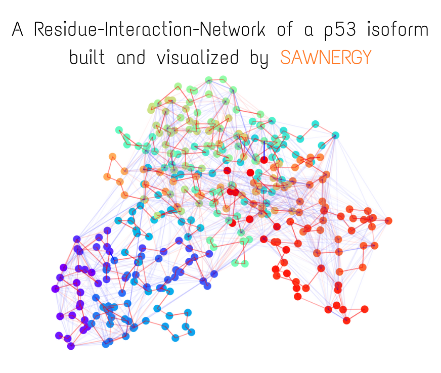
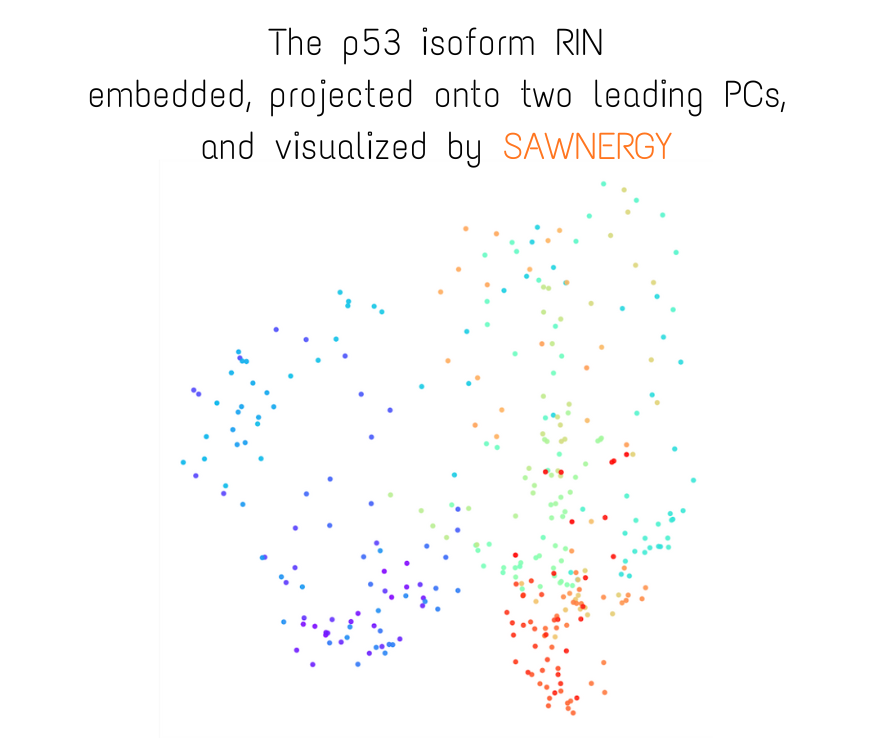
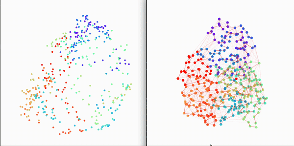

A Python 3.11+ toolkit that converts molecular dynamics (MD) trajectories into residue interaction networks (RINs), samples random and self-avoiding walks (RW/SAW), trains skip-gram embeddings (PureML or PyTorch backends), and visualizes both networks and embeddings. All artifacts are Zarr v3 archives stored as compressed `.zip` files with rich metadata so every stage can be reproduced.

[](https://pypi.org/project/sawnergy/) [](https://github.com/Yehor-Mishchyriak/SAWNERGY/blob/main/LICENSE)  [](https://github.com/Yehor-Mishchyriak/SAWNERGY) [](https://doi.org/10.14418/fbzn3s9i)

<h2>Contents</h2>

[TOC]

For custom trajectory features, start with [V2 custom trajectory features](#v2-custom-trajectory-features).

---

## Requirements
- Python >= 3.11.
- [`cpptraj`](https://ambermd.org/AmberTools.php) (AmberTools) discoverable on `PATH` **or** via `CPPTRAJ`, `AMBERHOME/bin`, or `CONDA_PREFIX/bin`. `RINBuilder` refuses to run without it.
- Default dependencies are installed via `pip install sawnergy`; PureML (`ym-pure-ml`) is bundled. PyTorch is optional but required for the `model_base="torch"` embedding backend (GPU if available).

---

## Installation
```bash
pip install sawnergy
# If you want the PyTorch backend, install torch separately:
# pip install torch
```

---

## Visual example from trajectory and topology files





---

## More visual examples

### Animated Temporal Residue Interaction Network of Full Length p53 Protein


### Residue Interaction Network of Full Length p53 Protein (on the right) and its Embedding (on the left)


---

## End-to-End Quick Start (make sure cpptraj is discoverable)
New here? This is the shortest possible runnable script. Point it at your own `topology/trajectory` pair or at the bundled p53 example (see **Quick-start MD example** below).
```python
from pathlib import Path
import logging
import torch  # optional, only when using model_base="torch"

from sawnergy.logging_util import configure_logging
from sawnergy.rin import RINBuilder
from sawnergy.walks import Walker
from sawnergy.embedding import Embedder

configure_logging("./logs", file_level=logging.WARNING, console_level=logging.INFO, force=True)

# 1) Build a Residue Interaction Network archive
rin_path = Path("RIN_demo.zip")
rin_builder = RINBuilder()  # auto-locates cpptraj
rin_builder.build_rin(
    topology_file="system.prmtop",
    trajectory_file="trajectory.nc",
    molecule_of_interest=1,
    frame_range=(1, 100),          # inclusive, 1-based
    frame_batch_size=10,           # processed in 10-frame batches
    prune_low_energies_frac=0.85,   # per-row quantile pruning
    include_attractive=True,
    include_repulsive=False,
    output_path=rin_path,
)

# 2) Sample random / self-avoiding walks
walks_path = Path("WALKS_demo.zip")
with Walker(rin_path, seed=123) as walker:
    walker.sample_walks(
        walk_length=16,
        walks_per_node=100,
        include_attractive=True,
        include_repulsive=False,
        time_aware=False,
        output_path=walks_path,
        in_parallel=False,      # required kwarg; set True only under a main-guard
    )

# 3) Train per-frame embeddings
embedder = Embedder(walks_path, seed=999)
emb_path = embedder.embed_all(
    RIN_type="attr",              # "attr" or "repuls"
    using="merged",               # "RW" | "SAW" | "merged"
    num_epochs=20,
    negative_sampling=True,      # SG (False) or SGNS (True)
    num_negative_samples=10,
    window_size=5,
    device="cuda" if torch.cuda.is_available() else "cpu",
    model_base="torch",
    kind="in",                    # stored embedding kind
    output_path="EMBEDDINGS_demo.zip",
)
print("Embeddings written to", emb_path)
```

```
MD Trajectory + Topology
          │
          ▼
      RINBuilder 
          │   →  RIN archive (.zip/.zarr) → Visualizer (display/animate RINs)
          ▼
        Walker
          │   →  Walks archive (RW/SAW per frame)
          ▼
       Embedder
          │   →  Embedding archive (frame × vocab × dim)
          ▼
     Downstream ML
```

Each stage consumes the archive produced by the previous one. Metadata embedded in the archives ensures frame order,
node indexing, and RNG seeds stay consistent across the toolchain.

### Biophysical intuition (why these steps exist)
- Residue Interaction Networks treat each amino acid as a node and the non-bonded interaction energy it exchanges with neighbors as a weighted edge. We split energies into attractive (Coulomb + vdW < 0) and repulsive (> 0) channels to respect the underlying physics: attractive edges guide paths along likely contact surfaces; repulsive edges highlight clashes or steric barriers.
- Quantile pruning removes the weakest interactions (default: bottom 85% of each row) so transient noise or solvent “fuzz” does not dominate the walk statistics. We keep the strongest contributors that are most likely to mediate allosteric communication.
- Row-wise L1 normalization converts the energy map into a transition probability matrix. The walker then behaves like a residue-to-residue diffusion process biased by interaction strength, which is a reasonable proxy for signal or force propagation paths through the protein.
- Random walks explore common routes; self-avoiding walks emphasize diverse, non-redundant paths. Time-aware walks allow transitions between frames when transition matrices remain similar, capturing slowly evolving conformations.
- Skip-gram embeddings treat walk paths like sentences: residues that frequently co-occur along walks share similar vectors. This encodes community structure (e.g., domains, loops around a binding pocket) and how it shifts over time.

---

## Quick-start MD example

A minimal dataset is available for download in `example_MD_for_quick_start/` on GitHub to let you run the full SAWNERGY pipeline immediately. [Download the example data](https://github.com/Yehor-Mishchyriak/SAWNERGY/tree/main/example_MD_for_quick_start)

- `p53_DBD.prmtop` (topology), `p53_DBD.pdb` (reference), `p53_DBD.nc` (trajectory)
- 1 µs production trajectory of the p53 DNA-binding domain, 1000 snapshots saved every 1 ns
- Credits: MD simulation produced by Sean Stetson (ORCID: 0009-0007-9759-5977)
- Intended use: quick-start tutorial for building RINs, sampling walks, and training embeddings without setting up your own MD run

See `example_MD_for_quick_start/brief_description.md`.

### Five-minute “first run” for newcomers
1. Install: `pip install sawnergy` (and `pip install torch` if you want GPU training). Confirm `cpptraj -h` works in your shell or set `CPPTRAJ=/path/to/cpptraj`.
2. Download the three p53 example files into a folder named `example_MD_for_quick_start` beside your script or notebook. Start Python from the folder containing that data folder.
3. Run the quick-start script above with `topology_file="example_MD_for_quick_start/p53_DBD.prmtop"` and `trajectory_file="example_MD_for_quick_start/p53_DBD.nc"`.
4. Inspect the outputs: `RIN_demo.zip`, `WALKS_demo.zip`, and `EMBEDDINGS_demo.zip` (all are Zarr-in-zip archives). Try `sawnergy.visual.Visualizer("RIN_demo.zip").build_frame(1, show=True)` to see the network.
5. Swap in your own trajectory/topology once you’ve seen the expected behavior.

---

## V2 custom trajectory features

V2 lets you calculate your own measurements from an MD trajectory and save them in a compressed
archive. Each example below defines a feature using a CPPTRAJ script, runs it through SAWNERGY,
and produces a ZIP archive that you can open in Python.

The examples cover RMSD, RMSF, residue-pair electrostatic and van der Waals energies, hydrogen-bond
counts, and protein–DNA hydrogen bonds, followed by an extra radius-of-gyration example.
Run the Python blocks in order. They can also become successive notebook cells.

### Prepare the files and Python session

Install or upgrade to SAWNERGY 2.0 or later in the Python environment used by your script or notebook.

```bash
python -m pip install --upgrade "sawnergy>=2.0"
```

Install AmberTools separately and make `cpptraj` available as described in Requirements.
Download `p53_DBD.prmtop`, `p53_DBD.nc`, and `p53_DBD.pdb` into a folder named
`example_MD_for_quick_start` beside your script or notebook. Start Python from the folder containing
that data folder, or set `example` below to its full path. [Download the example data](https://github.com/Yehor-Mishchyriak/SAWNERGY/tree/main/example_MD_for_quick_start)

```python
from io import StringIO
from pathlib import Path
from tempfile import TemporaryDirectory

import numpy as np

from sawnergy.rin.rin_util import locate_cpptraj, run_cpptraj
from sawnergy.sawnergy_util import ArrayStorage
from sawnergy.v2.traj_features.feature_extractor import (
    ExtractionContext,
    FeatureExtractor,
    feature,
)

example = Path("example_MD_for_quick_start").resolve()
topology_file = example / "p53_DBD.prmtop"
trajectory_file = example / "p53_DBD.nc"
cpptraj_path = locate_cpptraj()

print("Topology", topology_file)
print("Trajectory", trajectory_file)
print("CPPTRAJ", cpptraj_path)
```

You can also set `cpptraj_path = "/full/path/to/cpptraj"` directly.

### Select residues and set the time resolution

We start with three protein residues and ten frames to keep the first runs small.
Molecule, residue, atom, and source-frame numbers start at 1. Residue numbers refer to the topology
across the whole system and can differ from PDB labels.

```python
selection = {1: [20, 23, 26]}
residue_count = sum(len(residues) for residues in selection.values())

inputs = dict(
    topology_file=topology_file,
    trajectory_file=trajectory_file,
    cpptraj_path=cpptraj_path,
    selection=selection,
    frame_range=(1, 10),
    frame_stride=1,
    window_size=4,
    batch_size=2,
)
```

`selection={1: [20, 23, 26]}` selects complete residues 20, 23, and 26 from molecule 1.
Every atom of each selected residue is included. SAWNERGY orders residues by their topology numbers.
For another system, `{1: [10, 12], 3: [40, 45]}` would select residues from two molecules, provided
each residue belongs to the specified molecule.

| Setting | Effect |
| --- | --- |
| `frame_range=(1, 10)` | Read source frames 1 through 10, inclusive. `None` selects the whole file. |
| `frame_stride=1` | Keep every frame in the range. `2` keeps every other frame. |
| `window_size=4` | Group the selected frames into windows of four, keeping the final short window. |
| `batch_size=2` | Pass two windows at a time to each window feature. |

Here the windows contain frames `(1, 2, 3, 4)`, `(5, 6, 7, 8)`, and `(9, 10)`.
With `frame_range=(2, 11)`, `frame_stride=3`, and `window_size=3`, the windows would instead be
`(2, 5, 8)` and `(11,)`. Window size determines how much time each window result represents.
Batch size determines how many windows a method receives in one call.

Later examples use `**inputs` to pass these settings to `featurize()` as named arguments.
Edit this dictionary to change the shared settings. If you change the number of selected residues,
update `residue_count` and rerun the cell defining the RMSF class before extracting RMSF.

### Run this shared preparation cell once

The examples use the following small functions to run CPPTRAJ and read its text output.
In the scripts, `{mask}` is the selected-residue mask, `{trajectory}` is the trajectory filename,
and `{directory}` is a temporary output directory. The helper fills in these values for each call.
Keep this cell above the feature examples when copying them into a notebook.

```python
def cpptraj_files(ctx, frames, commands):
    """Run a CPPTRAJ script for selected frames and return its .dat file contents."""
    first, last = frames[0], frames[-1]
    stride = frames[1] - first if len(frames) > 1 else 1
    with TemporaryDirectory(prefix="sawnergy_example_") as directory:
        directory = Path(directory)
        topology = directory / ("topology" + ctx.topology_file.suffix)
        trajectory = directory / ("trajectory" + ctx.trajectory_file.suffix)
        topology.symlink_to(ctx.topology_file)
        trajectory.symlink_to(ctx.trajectory_file)
        script = (
            f'parm "{topology}"\n'
            f'trajin "{trajectory}" {first} {last} {stride}\n'
            + commands.format(
                mask=ctx.selection_mask, trajectory=trajectory, directory=directory,
            )
        )
        run_cpptraj(str(ctx.cpptraj), script=script)
        return {path.name: path.read_text() for path in directory.glob("*.dat")}


def table(text):
    """Read a numeric CPPTRAJ table, skipping its comment header."""
    return np.loadtxt(StringIO(text), comments="#", ndmin=2)


def frame_values(text, frames):
    """Read one measurement per processed frame and check the row order."""
    data = table(text)
    if data.shape != (len(frames), 2):
        raise ValueError("Expected one measurement per selected frame.")
    if not np.array_equal(data[:, 0], np.arange(1, len(frames) + 1)):
        raise ValueError("Unexpected CPPTRAJ output frame order.")
    return data[:, 1]


def window_means(values, windows):
    """Average per-frame measurements within each window, including a short last window."""
    means = []
    start = 0
    for window in windows:
        stop = start + len(window)
        means.append(values[start:stop].mean())
        start = stop
    return np.asarray(means, dtype="float64")
```

CPPTRAJ's output frame column counts processed frames from 1. SAWNERGY's `ctx.frame_ids` records their
original source-frame numbers, including any stride. The helper's `trajin` command reads that source
range with the appropriate stride. [CPPTRAJ frame-selection documentation](https://amberhub.chpc.utah.edu/trajin/)

### 1. Compute RMSD

RMSD measures how far a structure differs from a reference after fitting. This example uses all
selected atoms, equal atom weights, and a best fit by rotation and translation to source frame 1.
The `reference` command keeps that reference fixed across every batch. The feature returns the mean
per-frame RMSD in each window, in angstroms. Set `window_size=1` to retain a value for every selected
frame. [CPPTRAJ RMSD documentation](https://amberhub.chpc.utah.edu/rmsd/)

```python
class RMSDFeatures(FeatureExtractor):
    @feature(
        kind="global", scope="window", shape=(), dtype="float64",
        units="angstrom", statistic="mean best-fit all-atom RMSD to source frame 1",
    )
    def rmsd(self, ctx: ExtractionContext):
        """Average CPPTRAJ RMSD values within each window."""
        files = cpptraj_files(ctx, ctx.frame_ids, """
reference "{trajectory}" 1 [Start]
rms RMSD {mask} ref [Start] out "{directory}/rmsd.dat" prec 18.10
run
""")
        values = frame_values(files["rmsd.dat"], ctx.frame_ids)
        return window_means(values, ctx.windows)


rmsd_path = RMSDFeatures().featurize(**inputs, output_path="p53_rmsd.zip")
print("Saved", rmsd_path)
```

`class RMSDFeatures(FeatureExtractor)` defines your own extractor. `@feature(...)` tells SAWNERGY which
method to run and describes its output. Python supplies `self`, the extractor instance, and SAWNERGY
supplies `ctx`, the selected inputs for this call.

`kind="global"` means a measurement of the selected system. `scope="window"` requests one result per
window. `shape=()` declares a scalar, and `dtype="float64"` specifies the returned NumPy number type.
`units` and `statistic` are saved with the results. The feature returns an array of window values.

### 2. Compute RMSF

RMSF describes motion around an atom's average position over the selected frames. We follow CPPTRAJ's
fit-to-average workflow, first fitting frames to the first selected frame and constructing an average
structure, then fitting to that average before calculating fluctuations. `byres` gives a mass-weighted
average of the atomic RMSF values within each residue, in angstroms. The result contains one value per
selected residue, ordered as `ctx.residue_ids`. [CPPTRAJ RMSF documentation](https://amberhub.chpc.utah.edu/atomicfluct-rmsf/)

```python
class RMSFFeatures(FeatureExtractor):
    @feature(
        kind="global", scope="trajectory", shape=(residue_count,), dtype="float64",
        units="angstrom", statistic="per-residue atomic RMSF after fitting to average structure",
    )
    def rmsf(self, ctx: ExtractionContext):
        """Calculate residue RMSF across all selected frames in a single CPPTRAJ call."""
        files = cpptraj_files(ctx, ctx.frame_ids, """
rms {mask} first
average {mask} crdset Mean
run
rms {mask} ref Mean @*
atomicfluct Fluct {mask} byres out "{directory}/rmsf.dat" prec 18.10
run
""")
        data = table(files["rmsf.dat"])
        expected_ids = np.asarray([residue for molecule, residue in ctx.residue_ids])
        if data.shape != (len(expected_ids), 2) or not np.array_equal(data[:, 0], expected_ids):
            raise ValueError("RMSF output does not match the selected residue order.")
        return data[:, 1]


rmsf_path = RMSFFeatures().featurize(**inputs, output_path="p53_rmsf.zip")
print("Saved", rmsf_path)
```

`scope="trajectory"` runs this calculation once using all selected frames. For our three residues,
`shape=(residue_count,)` declares a vector of length three. Here `kind="global"` stores that vector
as one trajectory result. `byres` computes atomic fluctuations within residues, so interpret these
values using that definition. Changing `window_size` affects the other window features in this guide;
this RMSF calculation always uses the full selected frame range. The average structure contains only
the selected atoms, and `@*` selects those atoms when using it as the reference.

### 3. Compute average electrostatic and vdW energies between residues

These two features use CPPTRAJ `pairwise` to obtain separate electrostatic and van der Waals energies,
in kcal/mol. CPPTRAJ averages atomic interaction matrices over the frames of each window. Python sums
the atom-pair entries belonging to each residue pair. A negative entry indicates an attractive energy
contribution and a positive entry a repulsive contribution for that energy component.

The calculation uses the topology's exclusions and stored coordinates with nonperiodic distances.
`cuteelec 0` and `cutevdw 0` remove the reporting thresholds. Both matrices keep their signs and have
zero diagonals. [CPPTRAJ pairwise-energy documentation](https://amberhub.chpc.utah.edu/pairwise/)

```python
class EnergyFeatures(FeatureExtractor):
    def _mean_energy(self, ctx, aspect):
        """Sum a window-averaged atomic energy matrix into residue-pair energies."""
        counts = [len(atoms) for atoms in ctx.atom_ids]
        membership = np.repeat(np.arange(len(counts)), counts)
        projection = np.eye(len(counts))[membership]
        matrices = []
        for window in ctx.windows:
            commands = """
pairwise PW {mask} cuteelec 0 cutevdw 0
run
writedata "{directory}/energy.dat" PW[ASPECT] square2d noheader prec 18.10
""".replace("ASPECT", aspect)
            files = cpptraj_files(ctx, window, commands)
            atomic = table(files["energy.dat"])
            if atomic.shape != (len(membership), len(membership)):
                raise ValueError("Energy output does not match the selected atoms.")
            residues = projection.T @ atomic @ projection
            np.fill_diagonal(residues, 0.0)
            matrices.append(residues)
        return np.asarray(matrices, dtype="float64")

    @feature(
        kind="pairwise", scope="window", shape=("N", "N"), dtype="float64",
        units="kcal/mol", statistic="mean signed residue-pair electrostatic energy",
    )
    def electrostatics(self, ctx: ExtractionContext):
        """Return the electrostatic energy matrix for each window."""
        return self._mean_energy(ctx, "EMAP")

    @feature(
        kind="pairwise", scope="window", shape=("N", "N"), dtype="float64",
        units="kcal/mol", statistic="mean signed residue-pair van der Waals energy",
    )
    def vdw(self, ctx: ExtractionContext):
        """Return the van der Waals energy matrix for each window."""
        return self._mean_energy(ctx, "VMAP")


energy_path = EnergyFeatures().featurize(**inputs, output_path="p53_energies.zip")
print("Saved", energy_path)
```

`kind="pairwise"` and `shape=("N", "N")` describe a residue-pair matrix. `N` is the number of selected
residues. Both axes follow `ctx.residue_ids`, including pairs from different molecules if those
molecules are in your selection. With three windows and three residues, each saved energy array has
shape `(3, 3, 3)`, meaning window, row residue, column residue.

### 4. Compute the average number of hydrogen bonds between residues

This example uses CPPTRAJ's donor/acceptor search and the usual geometric settings, a donor–acceptor
heavy-atom distance cutoff of 3 Å and an acceptor–hydrogen–donor angle cutoff of 135°. Distances use
the stored coordinates. The residue matrix combines both donor directions and counts individual
hydrogen bonds, so more than one bond can contribute to a residue pair in a frame.
See the [CPPTRAJ hydrogen-bond documentation](https://amberhub.chpc.utah.edu/hbond/).

```python
class HbondFeatures(FeatureExtractor):
    @feature(
        kind="pairwise", scope="window", shape=("N", "N"), dtype="float64",
        units="1", statistic="mean number of hydrogen bonds per residue pair, both directions",
    )
    def mean_hbonds(self, ctx: ExtractionContext):
        """Average raw CPPTRAJ residue-pair bond counts over each window."""
        indices = np.asarray([residue - 1 for molecule, residue in ctx.residue_ids])
        matrices = []
        for window in ctx.windows:
            files = cpptraj_files(ctx, window, """
hbond HB {mask} dist 3.0 angle 135 uuresmatrix uuresmatrixnorm none
run
writedata "{directory}/hbonds.dat" HB[UUresmat] square2d noheader prec 18.10
""")
            raw = table(files["hbonds.dat"])
            if raw.shape[0] != raw.shape[1] or raw.shape[0] <= indices.max():
                raise ValueError("Hydrogen-bond matrix does not cover the selected residues.")
            means = raw[np.ix_(indices, indices)] / len(window)
            np.fill_diagonal(means, 0.0)
            matrices.append(means)
        return np.asarray(matrices, dtype="float64")


hbond_path = HbondFeatures().featurize(**inputs, output_path="p53_hbond_counts.zip")
print("Saved", hbond_path)
```

`uuresmatrixnorm none` requests accumulated counts. Dividing by the actual number of frames gives
mean counts, including for a short final window. For example, frame counts `[0, 2, 1, 1]` give a mean
of `1.0`. The saved matrices are symmetric with zero diagonals, and an entry of zero means that pair
formed no detected hydrogen bonds during the window. Keep `uuresmatrixnorm none` as shown here.
With CPPTRAJ V6.18.1 tested here, the normalized residue matrix reported `0.09` for a bond present
in 9 of 10 frames. Using raw counts and dividing explicitly gives the expected mean of `0.9`.

### 5. Examine protein–DNA hydrogen bonds

The bundled system contains the p53 protein and two DNA strands. These molecule and residue numbers
are specific to the bundled topology.

| Molecule | Relevant residues |
| --- | --- |
| `1` | Protein residues `1–194`; residue `195` is zinc. |
| `2` | DNA residues `196–216`. |
| `3` | DNA residues `217–237`. |

We select three protein residues and two DNA residues near the interface. Each residue pair gets
both a mean bond count and an occupancy. Occupancy is the fraction of selected frames in a window
with at least one bond between that pair. Counts `[0, 2, 1, 1]` therefore give occupancy `0.75` and
mean count `1.0`. Summing individual bond occupancies can exceed one; the pair occupancy here stays
between zero and one.

```python
interface_inputs = dict(inputs, selection={1: [185, 187, 188], 2: [208], 3: [222]})


class ProteinDNAFeatures(FeatureExtractor):
    def _counts(self, ctx, window):
        """Read per-frame counts for every selected protein–DNA residue pair."""
        pairs = [
            (i, j, protein, dna)
            for i, (protein_molecule, protein) in enumerate(ctx.residue_ids)
            for j, (dna_molecule, dna) in enumerate(ctx.residue_ids)
            if protein_molecule == 1 and dna_molecule in (2, 3)
        ]
        if not pairs:
            raise ValueError("Select protein residues and DNA residues from the bundled system.")
        commands = []
        for i, j, protein, dna in pairs:
            commands.append(
                f'hbond HB_{i}_{j} :{protein},{dna} nointramol dist 3.0 angle 135 '
                f'out "{{directory}}/pair_{i}_{j}.dat"'
            )
        files = cpptraj_files(ctx, window, "\n".join(commands + ["run"]))
        counts = np.zeros((len(window), len(ctx.residue_ids), len(ctx.residue_ids)))
        for i, j, protein, dna in pairs:
            values = frame_values(files[f"pair_{i}_{j}.dat"], window)
            counts[:, i, j] = values
            counts[:, j, i] = values
        return counts

    @feature(
        kind="pairwise", scope="window", shape=("N", "N"), dtype="float64",
        units="1", statistic="mean protein-DNA hydrogen-bond count per residue pair",
    )
    def mean_hbonds(self, ctx: ExtractionContext):
        """Return mean interface bond counts in each window."""
        return np.asarray([self._counts(ctx, window).mean(axis=0) for window in ctx.windows])

    @feature(
        kind="pairwise", scope="window", shape=("N", "N"), dtype="float64",
        units="1", statistic="fraction of frames with any protein-DNA hydrogen bond per residue pair",
    )
    def hbond_occupancy(self, ctx: ExtractionContext):
        """Return interface contact occupancy in each window."""
        return np.asarray([(self._counts(ctx, window) > 0).mean(axis=0) for window in ctx.windows])


interface_path = ProteinDNAFeatures().featurize(
    **interface_inputs, output_path="p53_protein_dna_hbonds.zip",
)
print("Saved", interface_path)
```

Each CPPTRAJ `hbond` command selects one protein residue and one DNA residue. `nointramol` restricts
the search to bonds between their molecules, with both donor directions included. The resulting
matrices contain protein–DNA pairs and their symmetric counterparts. Other entries are zero.
The molecule checks in this class refer to the bundled topology; update them for a different system.

This short run illustrates how to obtain the measurements. Increase the selected frames and residues
when examining the interface over a longer part of the simulation.

### Extra. Compute radius of gyration

Radius of gyration measures the spread of the selected atoms around their center. Here CPPTRAJ
computes mass-weighted values in angstroms, and Python averages them within each window. Use spatially
contiguous coordinates when interpreting this measurement for a periodic trajectory.
See the [CPPTRAJ radius-of-gyration documentation](https://amberhub.chpc.utah.edu/radgyr-rog/).

The second method also shows how to reuse a completed feature. `requires=("mean_rg",)` makes the
window results available through `ctx.dependencies["mean_rg"]`. The trajectory mean weights each
window by its actual frame count, so the short final window contributes the appropriate amount.

```python
class GyrationFeatures(FeatureExtractor):
    @feature(
        kind="global", scope="window", shape=(), dtype="float64",
        units="angstrom", statistic="mean per-frame mass-weighted radius of gyration",
    )
    def mean_rg(self, ctx: ExtractionContext):
        """Average CPPTRAJ radius-of-gyration values within each window."""
        files = cpptraj_files(ctx, ctx.frame_ids, """
radgyr Size {mask} mass nomax out "{directory}/rg.dat" prec 18.10
run
""")
        return window_means(frame_values(files["rg.dat"], ctx.frame_ids), ctx.windows)

    @feature(
        kind="global", scope="trajectory", shape=(), dtype="float64",
        units="angstrom", statistic="frame-weighted mean of window mean_rg values",
        requires=("mean_rg",),
    )
    def trajectory_mean_rg(self, ctx: ExtractionContext):
        """Combine saved window means with their actual frame counts."""
        weighted_sum = 0.0
        start = 0
        for means in ctx.dependencies["mean_rg"].block_iter(step=128):
            counts = [len(window) for window in ctx.windows[start:start + len(means)]]
            weighted_sum += np.dot(means, counts)
            start += len(means)
        return np.asarray(weighted_sum / len(ctx.frame_ids), dtype="float64")


gyration_path = GyrationFeatures().featurize(**inputs, output_path="p53_gyration.zip")
print("Saved", gyration_path)
```

### Open the archives and read the results

The `features` attribute connects your method names to saved arrays such as `feature_0`. It also
records each feature's units, statistic, shape, dtype, and dependencies. Look up the array names
through this list when reading an archive.

```python
with ArrayStorage(interface_path, mode="r") as archive:
    features = {entry["name"]: entry for entry in archive.get_attr("features")}
    mean_block = features["mean_hbonds"]["block"]
    occupancy_block = features["hbond_occupancy"]["block"]
    residue_ids = archive.read("residue_ids")
    frame_ids = archive.read("frame_ids")
    offsets = archive.read("window_offsets")

    print("Matrix row/column identities", residue_ids)
    for index in range(len(offsets) - 1):
        frames = frame_ids[offsets[index]:offsets[index + 1]]
        print("Window", index, "source frames", frames)
        print("Mean bond counts", archive.read(mean_block, index))
        print("Occupancies", archive.read(occupancy_block, index))

    print("First two window matrices", archive.read(mean_block, slice(0, 2)))
    for batch in archive.block_iter(mean_block, step=2):
        print("Result batch shape", batch.shape)
```

For this protein–DNA example, each feature array has shape `(3, 5, 5)`. The three windows each
contain a matrix for five residues. For example, position `[0, 3]` in a window matrix connects
protein residue 185 with DNA residue 208, following the saved residue list.

Here is how to read the earlier scalar and vector examples.

```python
with ArrayStorage(rmsd_path, mode="r") as archive:
    block = archive.get_attr("features")[0]["block"]
    print("Window RMSD, angstrom", archive.read(block))

with ArrayStorage(rmsf_path, mode="r") as archive:
    block = archive.get_attr("features")[0]["block"]
    fluctuations = archive.read(block, 0)
    for identity, value in zip(archive.read("residue_ids"), fluctuations):
        print("Molecule/residue", identity, "RMSF, angstrom", float(value))

with ArrayStorage(energy_path, mode="r") as archive:
    for entry in archive.get_attr("features"):
        print(entry["name"], entry["units"], archive.read(entry["block"], 0))
```

Trajectory features are stored with a single leading sample, so `read(block, 0)` retrieves that
result. `ArrayStorage` and dependency readers use zero-based array positions. Source-frame, molecule,
residue, and atom identities remain 1-based. Reads return independent NumPy copies that you can keep
after the `with` block. For larger archives, read slices or iterate over batches.

### Write your own feature methods

Choose `kind` and `scope` independently according to what you want to measure. In the table below,
`N` is the number of selected residues, `B` the number of windows in the current call, and `W` the
total number of windows saved in the archive.

| Measurement | Declaration | Return from your method | Saved array |
| --- | --- | --- | --- |
| Residue pairs, per window | `kind="pairwise", scope="window", shape=("N", "N")` | `(B, N, N)` | `(W, N, N)` |
| Selected system, per window | `kind="global", scope="window", shape=()` | `(B,)` | `(W,)` |
| Residue pairs, whole selection of frames | `kind="pairwise", scope="trajectory", shape=("N", "N")` | `(N, N)` | `(1, N, N)` |
| Selected system, whole selection of frames | `kind="global", scope="trajectory", shape=()` | Scalar ndarray `()` | `(1,)` |

A global feature can also return a fixed-size vector. With `shape=(3,)`, a window method returns
`(B, 3)` and a trajectory method returns `(3,)`. Return a NumPy array with the exact declared dtype,
for example `np.asarray(values, dtype="float64")`. Scalar trajectory results also use `np.asarray(...)`.
Every value must be finite. For undefined measurements, raise an informative error or use a
scientifically justified finite convention described in your feature's documentation.

Use the fields below when implementing a calculation. A window call receives just its current batch
of windows and frames. A trajectory call receives all frames selected by the extraction settings.

| Context field | What your method receives |
| --- | --- |
| `ctx.cpptraj` | Resolved path to the executable passed to `featurize()`. |
| `ctx.topology_file`, `ctx.trajectory_file` | Resolved paths to the input files. |
| `ctx.residue_ids` | Ordered `(molecule_id, topology_residue_id)` pairs. Use this order on both pairwise axes. |
| `ctx.atom_ids` | One tuple of topology atom IDs per residue, in the same residue order. |
| `ctx.selection_mask` | CPPTRAJ mask selecting the complete chosen residues. |
| `ctx.frame_ids` | Source frame numbers for this call. |
| `ctx.windows` | Source frames belonging to each window in this call. |
| `ctx.dependencies` | Read-only readers for exactly the feature names declared in `requires`. |

Dependency readers support `.read()`, `.read(0)`, `.read(slice(0, 2))`, and `.block_iter(step=2)`.
For a window feature reading another window feature, row `0` means the first window in the current
batch. A trajectory feature sees the complete dependency. A trajectory dependency always exposes its
single saved sample. Use readers during the feature call and keep copied values if you need them later.

Features run in their definition order, with inherited features before newly added methods. To change
an inherited feature, override its method with a new `@feature(...)` declaration. Overriding a method
without `@feature` removes it from extraction. Keep every dependency earlier in the resulting order.

Your method chooses the physical definition, units, coordinate processing, and reduction. Use only
the selected atoms and source frames. Align backend results to `ctx.residue_ids` and `ctx.frame_ids`
before returning them. Describe the choices in the method's docstring and in `units` and `statistic`.
SAWNERGY checks returned array shapes, dtypes, and finite values before saving them.

### Archive contents and common errors

V2 archives carry `schema_name="traj_features"`, integer `schema_version=1`, and a `producer_version`
identifying the SAWNERGY package version. They contain the feature list, source paths, extraction
settings, and identity arrays alongside your feature arrays.

`residue_ids` lists the matrix row/column identities. `atom_ids` and `atom_offsets` identify each
residue's atoms. `frame_ids` and `window_offsets` identify each window's source frames, as shown in
the reading example. Open these archives with `ArrayStorage`. The RIN, walk, and embedding readers
consume their corresponding archive types.

| Problem | What to check |
| --- | --- |
| V2 imports fail | Upgrade to SAWNERGY 2.0 or later with `python -m pip install --upgrade "sawnergy>=2.0"` in the Python environment used by your script or notebook. |
| An input file cannot be found | Check the working directory and the printed source paths in the setup block. |
| CPPTRAJ cannot be found or executed | Check `cpptraj_path`, or set `CPPTRAJ` to its executable path before calling `locate_cpptraj()`. |
| A molecule/residue pair is rejected | Use topology-global residue IDs and check which molecule owns each residue. |
| A dependency is unavailable | Put its decorated method earlier and use its exact method name in `requires`. |
| Output shape is rejected | Include one leading result per window for window features; return the declared sample shape for trajectory features. |
| Output dtype is rejected | Return the exact dtype declared in `@feature`, including any explicitly declared byte order. |
| Output contains NaN or infinity | Handle the undefined measurement in your feature before returning, or raise an error explaining why extraction cannot continue. |

Extraction errors are raised to the caller. If extraction, validation, or compression fails before
publication, an existing destination remains intact. Successful publication replaces it with the
completed ZIP archive. A subsequent cleanup error can be raised after that replacement has occurred.

---

## Archive Layouts (Zarr v3 in .zip)

All archives are Zarr v3 groups and can be opened directly with `sawnergy.sawnergy_util.ArrayStorage` (read via `mode="r"`; write/append via `mode="a"`/`"w"`). When compressed as `.zip`, they are **read-only**; create/append uses the `.zarr` directory form or a temporary store prior to compression.

<div class="table-scroll" role="region" aria-label="SAWNERGY archive layouts" tabindex="0" markdown="block">

| Archive | Core datasets (name → shape, dtype) | Key root attrs |
| --- | --- | --- |
| **RIN** | `ATTRACTIVE_transitions` `(T, N, N)` float32 (opt) • `REPULSIVE_transitions` `(T, N, N)` float32 (opt) • `ATTRACTIVE_energies` `(T, N, N)` float32 (opt; pre-normalized) • `REPULSIVE_energies` `(T, N, N)` float32 (opt) • `COM` `(T, N, 3)` float32 | `com_name="COM"` • `molecule_of_interest` • `frame_range` (tuple or None) • `frame_batch_size` • `prune_low_energies_frac` • `attractive_transitions_name` / `repulsive_transitions_name` (may be `None`) • `attractive_energies_name` / `repulsive_energies_name` (may be `None`) • `time_created` |
| **Walks** | `ATTRACTIVE_RWs` `(T, N·num_RWs, L+1)` uint16 (opt) • `REPULSIVE_RWs` `(T, N·num_RWs, L+1)` uint16 (opt) • `ATTRACTIVE_SAWs` `(T, N·num_SAWs, L+1)` uint16 (opt) • `REPULSIVE_SAWs` `(T, N·num_SAWs, L+1)` uint16 (opt) | `seed` • `num_workers` • `in_parallel` • `batch_size_nodes` • `num_RWs` • `num_SAWs` • `node_count` • `time_stamp_count` • `walk_length` • `walks_per_node` • dataset name attrs for each channel (may be `None`) • `walks_layout="time_leading_3d"` • `time_created` |
| **Embeddings** | `FRAME_EMBEDDINGS` `(T, N, D)` float32 | `frame_embeddings_name` • `time_stamp_count` • `node_count` • `embedding_dim` • `model_base` • `embedding_kind` (`"in"|"out"|"avg"`) • `objective` (`"sg"` or `"sgns"`) • `negative_sampling` • `num_epochs` • `batch_size` • `window_size` • `alpha` • `num_negative_samples` • `lr_step_per_batch` • `shuffle_data` • `device_hint` • `model_kwargs_repr` • `RIN_type` (`"attr"|"repuls"`) • `using` (`"RW"|"SAW"|"merged"`) • `source_WALKS_path` • walk metadata passthrough • `master_seed` • `per_frame_seeds` • `arrays_per_chunk` • `compression_level` • `created_at` |
| **V2 trajectory features** | `feature_0`, `feature_1`, ... with one sample per window or one sample for trajectory scope; `residue_ids`, `atom_ids`, `atom_offsets`, `frame_ids`, `window_offsets` | `schema_name="traj_features"` • `schema_version=1` • `producer_version` • ordered `features` list • source paths • `frame_range` • `frame_stride` • `window_size` |

</div>

`T` equals the number of frame **batches** produced by `RINBuilder` (i.e., `frame_range` swept in `frame_batch_size` steps). Walk node ids are **1-based** in storage; embedding training converts them to 0-based internally.

---

## Stage Reference

### RINBuilder (`sawnergy.rin.RINBuilder`)
- Purpose: run `cpptraj`, compute per-frame atomic EMAP/VMAP energies, project to residues, split into attractive/repulsive channels, prune, symmetrize, L1-normalize into transition matrices, and write a compressed archive.
- Construction: `RINBuilder(cpptraj_path=None)` auto-resolves `cpptraj` by checking an explicit path, `CPPTRAJ`, `PATH`, `AMBERHOME/bin`, then `CONDA_PREFIX/bin` (verification via `cpptraj -h`).
- `build_rin(...)` (returns output path as `str`):
  - Required: `topology_file`, `trajectory_file`, `molecule_of_interest` (e.g., `1` for `^1` mask in CPPTRAJ), `frame_range` (tuple or None).
  - Defaults: `frame_batch_size=-1` (all selected frames in one batch), `prune_low_energies_frac=0.85`, `keep_prenormalized_energies=True`, `include_attractive=True`, `include_repulsive=True`, `parallel_cpptraj=False`, `simul_cpptraj_instances=None` (→ `os.cpu_count()`), `num_matrices_in_compressed_blocks=10`, `compression_level=3`.
  - Processing per batch:
    1. `cpptraj pairwise` over the selected frame range → EMAP + VMAP → summed atomic interaction matrix (float32).
    2. Project to residues with the compositional mask `R = Pᵀ @ A @ P`.
    3. Split into channels (negative → attractive magnitude, positive → repulsive).
    4. Per-row quantile pruning at `q=prune_low_energies_frac` (applied independently to both channels).
    5. Zero diagonals, symmetrize `(M + Mᵀ)/2`, then row-wise L1 normalize (transition probabilities; breaks symmetry).
    6. Optionally persist pre-normalized energies; always persist normalized transitions for requested channels.
    7. Compute per-frame residue COMs for the batch and store their **batch mean** (so `T` equals the number of batches, not raw frames when `frame_batch_size>1`).
  - Output: compressed `.zip` (Zarr v3). Dataset names are recorded in attrs; absent channels are set to `None`. Types are float32 for matrices and COMs.
  - Notes: cpptraj tasks can be threaded (`parallel_cpptraj=True`); BLAS is kept single-threaded in that mode to avoid oversubscription.

### Walker (`sawnergy.walks.Walker`)
- Purpose: load **transition** matrices from a RIN archive into shared memory and sample RW/SAW paths (optionally time-aware).
- Construction: `Walker(RIN_path, seed=None)`; resolves transition dataset names from RIN attrs. Raises if neither channel exists or shapes are not `(T,N,N)` with matching `N`.
  - Shared memory: matrices live in `SharedNDArray`; call `close()` (or use `with Walker(...)`) to release and unlink segments.
  - RNG: a master seed is stored; child seeds per batch derive from `numpy.random.SeedSequence`.
- Key methods:
  - `_extract_prob_vector(node, time_stamp, interaction_type)` returns the transition row (float) for a node/time, renormalized after any masking.
  - `walk(start_node=None, start_time_stamp=None, length, interaction_type, self_avoid=False, time_aware=False, stickiness=None, on_no_options=None)` → `(length+1,)` array of **1-based** node ids. When `time_aware=True`, `stickiness` (probability of staying) and `on_no_options` (`"raise"` or `"loop"`) are mandatory; time steps are chosen by cosine similarity between transition matrices.
  - SAW dead-ends: if self-avoidance removes all probability mass for a step, the sampler logs a warning and falls back to an unconstrained RW move instead of raising.
  - `sample_walks(walk_length, walks_per_node, *, saw_frac=0.0, include_attractive=True, include_repulsive=False, time_aware=False, stickiness=None, on_no_options=None, output_path=None, in_parallel, max_parallel_workers=None, compression_level=3, num_walk_matrices_in_compressed_blocks=None)` → path to walks archive.
    - `in_parallel` is required (process-based via `ProcessPoolExecutor`); guard with `if __name__ == "__main__":` when `True`.
    - Per-node counts: `num_SAWs = round(walks_per_node * saw_frac)`, `num_RWs = walks_per_node - num_SAWs`.
    - Walk tensors are shaped `(T, total_walks, L+1)` with dtype `uint16`; time-aware walks live in the layer of their **start** time.
    - Metadata includes seeds, worker counts, and dataset names (`ATTRACTIVE_RWs`, `ATTRACTIVE_SAWs`, etc.; missing channels are stored as `None`).
  - Why walks: they approximate how “signals” or perturbations might diffuse through the contact network. SAWs reduce backtracking, biasing toward alternative corridors; RWs keep a faithful probability flow.
  - Recommended usage: keep to regular (time-stationary) walks on the **attractive** network for now. Mix in a modest SAW fraction (e.g., 0.1–0.3) when you want to encourage exploration of farther residues from each node, similar to the DFS/BFS tradeoff in node2vec’s `p`/`q` tuning.
  - Experimental flag: time-aware walks are provided for research use but are less battle-tested than stationary walks; prefer the stationary API unless you specifically need temporal hopping.

### Embedder (`sawnergy.embedding.Embedder`)
- Purpose: turn walk corpora into skip-gram training pairs and fit embeddings per frame with either PureML (default) or PyTorch backends.
- Construction: `Embedder(WALKS_path, seed=None)`; loads available RW/SAW datasets and validates shapes against stored metadata. Walks are 1-based in storage and converted to 0-based internally.
- Single frame: `embed_frame(frame_id, RIN_type, using, num_epochs, *, negative_sampling=False, window_size=2, num_negative_samples=10, batch_size=1024, in_weights=None, out_weights=None, lr_step_per_batch=False, shuffle_data=True, dimensionality=128, alpha=0.75, device=None, model_base="pureml", model_kwargs=None, kind=("in",), _seed=None)` → list of `(embedding, kind)` tuples sorted as `avg`, `in`, `out`.
  - `RIN_type`: `"attr"` or `"repuls"`. `using`: `"RW"`, `"SAW"`, or `"merged"` (concatenates available RW and SAW for that channel).
  - Negative sampling toggles SGNS vs SG. Noise distributions are built **only** when `negative_sampling=True`.
  - Warm starts: `in_weights` shape `(V,D)` for all backends. `out_weights` shape `(V,D)` for SGNS; `(D,V)` for SG (the SG torch/PureML implementations transpose or expect that shape).
  - Raises if no pairs are produced or walks are missing.
- All frames: `embed_all(..., kind="in", output_path=None, num_matrices_in_compressed_blocks=20, compression_level=3)` → archive path.
  - Seeds: master seed stored; per-frame seeds derived deterministically and recorded in `per_frame_seeds`.
  - Warm start across frames: each frame initializes from the previous frame’s embeddings (`out` transposed for SG so shapes match).
  - Output dataset `FRAME_EMBEDDINGS` is float32 with shape `(T,N,D)`, where `T` is the walk archive’s `time_stamp_count`.
  - Why embeddings: residues that share walk context get nearby vectors, revealing communities or binding-site neighborhoods. Comparing embeddings across frames highlights how those communities reorganize over time (possible allosteric shifts).

Backends:

- `model_base="pureml"` (default): uses `SGNS_PureML` or `SG_PureML` (no biases). Device hint is ignored (PureML is CPU-only).
- `model_base="torch"`: uses `SGNS_Torch` or `SG_Torch` (no biases). Defaults to CUDA if available unless `device` overrides it.

### Visualizers
- RIN Visualizer (`sawnergy.visual.Visualizer`):
  - Loads COM coordinates and optional attractive/repulsive energies from a RIN archive (dataset names resolved via attrs). If an energy channel is absent (`None`), that edge layer is skipped.
  - `build_frame(frame_id, displayed_nodes="ALL", displayed_pairwise_attraction_for_nodes="DISPLAYED_NODES", displayed_pairwise_repulsion_for_nodes="DISPLAYED_NODES", frac_node_interactions_displayed=0.01, global_interactions_frac=True, global_opacity=True, global_color_saturation=True, node_colors=None, title=None, padding=0.1, spread=1.0, show=False, *, show_node_labels=False, node_label_size=6, attractive_edge_cmap="autumn", repulsive_edge_cmap="winter")`.
    - Node selectors are 1-based; validation rejects non-integers before conversion.
    - Edge candidates are filtered to the specified nodes, then the heaviest fraction is drawn; color/opacity scaling can be global or restricted to kept edges.
  - `animate_trajectory(start=1, stop=None, step=1, interval_ms=50, loop=False, **build_kwargs)` reuses `build_frame`; enforces `show=False` during iteration and finally calls `show()` once for a single pass. Negative `step` plays backwards.
  - Backend handling: `ensure_backend(show)` picks a GUI backend; if `show=True` but no display is available, falls back to `Agg` and emits a warning.
- Embedding Visualizer (`sawnergy.embedding.Visualizer`):
  - Loads `FRAME_EMBEDDINGS` from an embeddings archive; optional `normalize_rows=True` L2-normalizes rows before PCA.
  - `build_frame(frame_id, *, node_colors="rainbow", displayed_nodes="ALL", show_node_labels=False, show=False)` projects the selected frame to 3D via SVD-based PCA (pads to 3 coordinates if `D<3`). Node selectors are 1-based and validated.
  - Shares color semantics with the RIN visualizer (`node_colors` can be a colormap string, per-node RGBA array shaped `(N,3|4)`, or group tuples).

### Example code

```python
from sawnergy.visual import Visualizer

v = Visualizer("./RIN_demo.zip")
v.build_frame(1,
    node_colors="rainbow",
    displayed_nodes="ALL",
    displayed_pairwise_attraction_for_nodes="DISPLAYED_NODES",
    displayed_pairwise_repulsion_for_nodes="DISPLAYED_NODES",
    show_node_labels=True,
    show=True
)
```

`Visualizer` lazily loads datasets and works even in headless environments (falls back to the `Agg` backend).

```python
from sawnergy.embedding import Visualizer

viz = Visualizer("./EMBEDDINGS_demo.zip", normalize_rows=True)
viz.build_frame(1, show=True)
```

---

### Utilities
- `ArrayStorage`: thin wrapper over Zarr v3 groups backed by a `.zarr` directory or read-only `.zip`. Handles per-block chunk metadata, JSON-safe attrs, block iteration, and compression via `compress(into=..., compression_level)` or context-managed `compress_and_cleanup(output_pth, compression_level)`.
  - `write` appends along axis 0; `read` and `block_iter` return NumPy arrays (copies). Default chunk length when unset is 10 with a warning.
  - Root attrs always include `array_chunk_size_in_block`, `array_shape_in_block`, and `array_dtype_in_block`.
- `logging_util.configure_logging(logs_dir, file_level=logging.WARNING, console_level=logging.WARNING, force=False)` installs a timed rotating file handler plus console handler. When `force=True`, existing root handlers are removed first.

---

## Practical Notes
- `Walker.sample_walks` uses process-based parallelism; wrap calls in `if __name__ == "__main__":` when `in_parallel=True`. Shared memory segments are unlinked only by the creating process; call `close()` (or use a context manager) to avoid leaks.
- Time-aware walks require `stickiness` in `[0,1]` and `on_no_options` set to `"raise"` or `"loop"`. Time transitions are chosen by cosine similarity between transition matrices, renormalized before sampling.
- Transition matrices coming from `RINBuilder` are row-normalized probabilities; `_step_node` renormalizes again after any avoidance masks to keep probabilities valid.
- Frame dimension `T` equals the number of **frame batches**, not necessarily the raw frame count if `frame_batch_size > 1`.
- Missing channels are represented by `None` in attrs; downstream stages skip them gracefully (e.g., repulsive walks/edges/embeddings are absent if never built).
- Stability note: time-aware walks remain experimental; stick to stationary walks on the attractive network plus a small SAW fraction when you want deeper-but-not-hopping exploration.

---

## Project Structure

```
├── sawnergy/
│   ├── rin/           # RINBuilder and cpptraj integration helpers
│   ├── walks/         # Walker class and shared-memory utilities
│   ├── embedding/     # Embedder + SG/SGNS backends (PureML / PyTorch)
│   ├── visual/        # Visualizer and palette utilities
│   ├── v2/
│   │   └── traj_features/
│   │       └── feature_extractor.py  # Custom features, contexts, dependency readers
│   │
│   ├── logging_util.py
│   └── sawnergy_util.py
│
└── README.md
```

---

## Minimal API Cheatsheet

- V2 features use your subclass as above, e.g. `RMSDFeatures().featurize(topology_file, trajectory_file, cpptraj_path, selection, output_path="features.zip", frame_range=None, frame_stride=1, window_size=1, batch_size=1, compression_level=3)`.
- Build RIN: `RINBuilder().build_rin(topology_file, trajectory_file, molecule_of_interest, frame_range, frame_batch_size=-1, prune_low_energies_frac=0.85, keep_prenormalized_energies=True, include_attractive=True, include_repulsive=True, parallel_cpptraj=False, simul_cpptraj_instances=None, num_matrices_in_compressed_blocks=10, compression_level=3)`
- Walks: `Walker(rin_path, seed=None).sample_walks(walk_length, walks_per_node, saw_frac=0.0, include_attractive=True, include_repulsive=False, time_aware=False, stickiness=None, on_no_options=None, output_path=None, in_parallel=False, max_parallel_workers=None, compression_level=3, num_walk_matrices_in_compressed_blocks=None)`
- Embeddings: `Embedder(walks_path, seed=None).embed_all(RIN_type, using, num_epochs, negative_sampling=False, window_size=2, num_negative_samples=10, batch_size=1024, lr_step_per_batch=False, shuffle_data=True, dimensionality=128, alpha=0.75, device=None, model_base="pureml", model_kwargs=None, kind="in", output_path=None, num_matrices_in_compressed_blocks=20, compression_level=3)`
- Visualization: `sawnergy.visual.Visualizer(rin_path, show=False).build_frame(...)` or `.animate_trajectory(...)`; `sawnergy.embedding.Visualizer(emb_path, normalize_rows=False).build_frame(...)`.

All functions raise informative `ValueError`/`RuntimeError` when inputs are inconsistent (e.g., missing walks, out-of-range frame ids, invalid quantiles). Attributes recorded in each archive are intended to be sufficient to reproduce downstream stages without additional bookkeeping.
